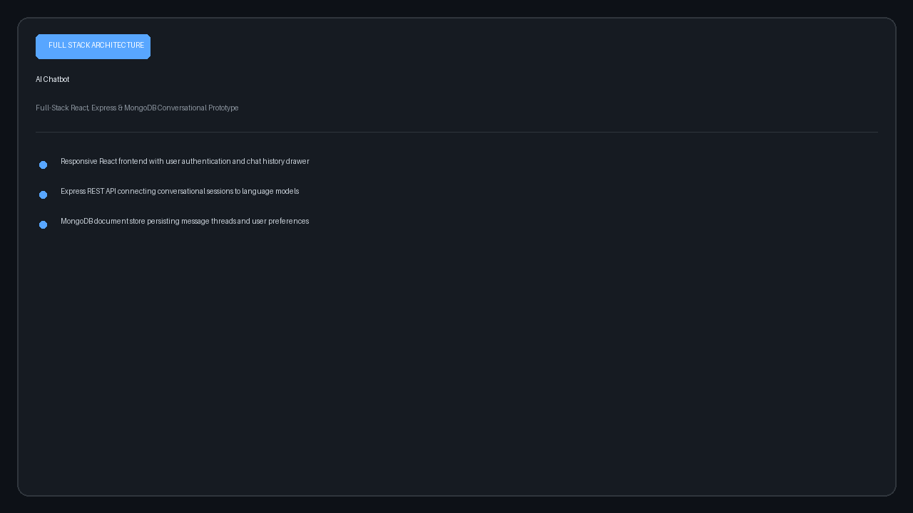

# AI Chatbot

> **Full-stack React, Express, and MongoDB conversational prototype.**

[](media/walkthrough.mp4)

*Click the preview card above to watch the architecture walkthrough.*

---

## Why I Built This

Building conversational interfaces requires seamless synchronization between client-side optimistic rendering, streaming backend API proxies, and durable database persistence.

This project implements a full-stack conversational prototype featuring a React frontend, an Express REST backend with model streaming, and a MongoDB document store for multi-session thread history.

## Standout Features

- **React Chat Canvas:** Responsive sidebar for thread switching and real-time message bubble rendering.
- **Express Model Middleware:** Manages authentication tokens, prompt templates, and streaming model responses.
- **MongoDB Session Persistence:** Durable storage of conversational history and user preferences.

## Media

- **Architecture Card:** `media/overview.png`
- **Walkthrough Video:** `media/walkthrough.mp4`

## Running Locally

```bash
# Backend
cd backend && npm install && npm run dev

# Frontend
cd frontend && npm install && npm start
```
